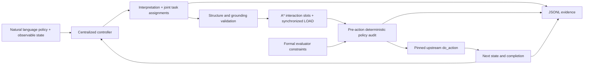

# Policy2Action recovery testbed

Centralized natural-language policy → task assignments → A* and synchronized
loads → **real, pinned ADLEAP-MAS LevelForagingEnv**. No simulator replacement;
no modifications to either checkout's `src/`. Historical measurements remain
unverified. The default is free deterministic inference.

From the repository root, with Python 3.12 available:

```bash
python3.12 -m venv experiments/llm_lbf_demo/.venv
experiments/llm_lbf_demo/.venv/bin/python -m pip install -r experiments/llm_lbf_demo/requirements.lock
experiments/llm_lbf_demo/.venv/bin/python experiments/llm_lbf_demo/bootstrap.py
export MPLCONFIGDIR=/private/tmp/policy2action-mpl
experiments/llm_lbf_demo/.venv/bin/python -m unittest discover -s experiments/llm_lbf_demo/tests -v
experiments/llm_lbf_demo/.venv/bin/python experiments/llm_lbf_demo/testbed.py --scenario conditional --condition reference --output /private/tmp/p2a-reference.jsonl
experiments/llm_lbf_demo/.venv/bin/python experiments/llm_lbf_demo/testbed.py --scenario conditional --condition blind --output /private/tmp/p2a-blind.jsonl
experiments/llm_lbf_demo/.venv/bin/python experiments/llm_lbf_demo/testbed.py --scenario conditional --condition llm_mock --fake-mode misinterpret --output /private/tmp/p2a-misinterpret.jsonl
experiments/llm_lbf_demo/.venv/bin/python experiments/llm_lbf_demo/testbed.py --suite /private/tmp/p2a-suite
```

Choose fresh output paths: logs and suite directories refuse overwrite. The
verified interpreter on this machine was `/opt/anaconda3/envs/policy2action/bin/python`
(Python 3.12.16), used to create the isolated `.venv`. System `python3` was 3.15
and lacked NumPy; do not assume it is the experiment interpreter.

`bootstrap.py` clones the official repository into ignored `vendor/adleap-mas`
and checks out the full SHA in `upstream.lock.json`. Every process verifies the
pin, source cleanliness, and imported module location. Internet is needed only
for setup and optional explicitly approved inference. Matplotlib is required by
upstream's eager imports even though experiments are headless. `requirements.lock`
pins the complete 15-package headless dependency closure, verified in a fresh venv.

`scenarios.json` stores explicit policy texts and evaluator constraints. Extend
this small configuration and `make_env` for new layouts. Configurations are
trusted experiment definitions, not inferred ground truth. The fake model is a
scripted fixture keyed by exact policy text; it has **no language understanding**.
The reference gets formal rules; the model request receives only policy text and
serialized observable world state. Both the mock and optional LLM use the same
validated decision contract. Baselines share the same navigation code.

Available scenarios: permitted/prohibited cooperation (matched light tasks),
heavy_permitted/exception (matched heavy tasks), and unrestricted_pair/conditional
(the decisive matched ordering pair). Conditions: blind, reference, llm_mock, llm.
The seed is fixed, but these collision-free layouts are deterministic across all
three suite seeds; they are replay checks, not independent experimental samples.

Optional real LLM inference is implemented with Python's standard-library HTTP
client in `llm_backend.py`. It is disabled without `--allow-paid-api`; no real
calls were made during recovery. After obtaining approval, set `OPENAI_API_KEY`
in the process environment and run `--condition llm --allow-paid-api --model MODEL
--input-price INPUT_USD_PER_MILLION --output-price OUTPUT_USD_PER_MILLION` with the
normal scenario and output options. Supply verified current prices; none are
hardcoded. The backend permits at most ten requests per run, sets a token limit,
and does not retry. Logs contain raw responses, token usage, returned model ID,
response ID, latency and estimated cost. Actual billed cost is unknown for real
calls; failed requests may also incur cost. The model name is configurable and
its availability has not been tested. The test suite exercises this branch using
an injected local backend without network access or credentials.

See [RECOVERY_REPORT.md](RECOVERY_REPORT.md), [EXPERIMENT_PLAN.md](EXPERIMENT_PLAN.md)
and [RESULTS.md](RESULTS.md). Logs contain full state and response data; inspect
before sharing if future scenarios contain sensitive material.



The audit records violations and does not block them. This permits measuring
cheating separately from successful task collection. `None` is the transition's
no-op; `0` is East. `env.step` invokes decentralized teammate reasoning, so the
joint adapter sets all actions and calls upstream `do_action` once per tick.
It advances `env.episode`; it does not claim Gym wrapper/reset equivalence.
Movement is conservatively serialized and blocks other agents' current cells.
Cooperative loads synchronize. This small coordinator is not an optimal or
complete multi-agent planner; global makespan optimality is not claimed.

The subsequent [E1 offline harness](e1/README.md) implements the amended paired
require/forbid snapshot protocol. Its separate artifacts and acceptance report
supersede the episode demo as the next experimental milestone; historical/demo
results remain preserved.
